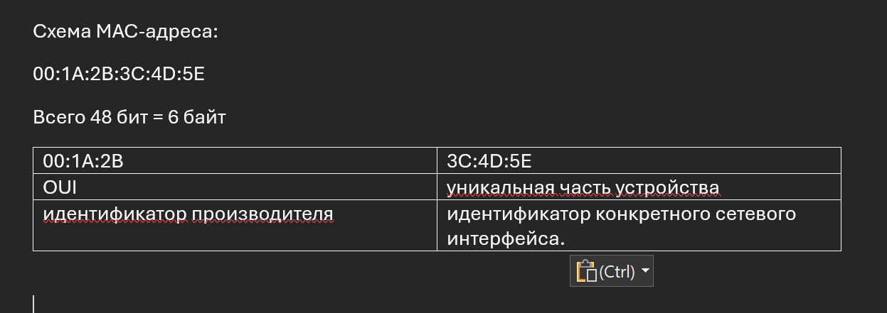
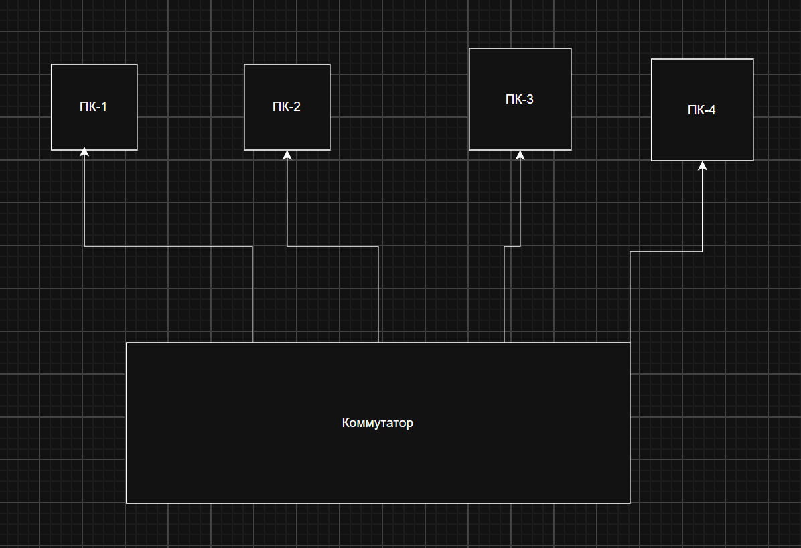
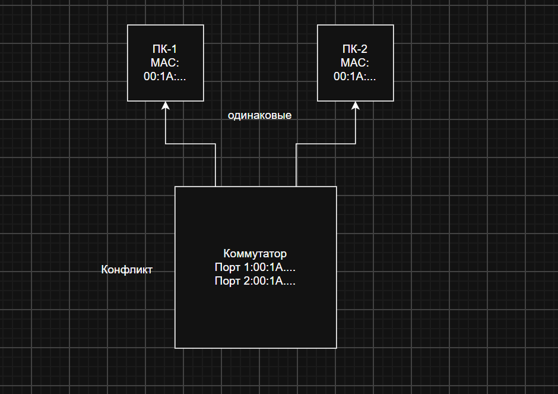

# Работа 2. Ethernet-адреса

## MAC-адрес

На иллюстрации показан шестибайтовый адрес `00:1A:2B:3C:4D:5E`. Левая половина содержит код организации-производителя, правая назначается конкретному интерфейсу.

## Коммутатор и подключенные устройства

Схема показывает четыре конечных устройства и коммутатор, который соединяет их в локальный сегмент.

На третьем рисунке приведен случай, когда два сетевых интерфейса используют один MAC-адрес. Коммутатор связывает адрес с портами, поэтому дублирование приводит к неоднозначности при пересылке кадров.

