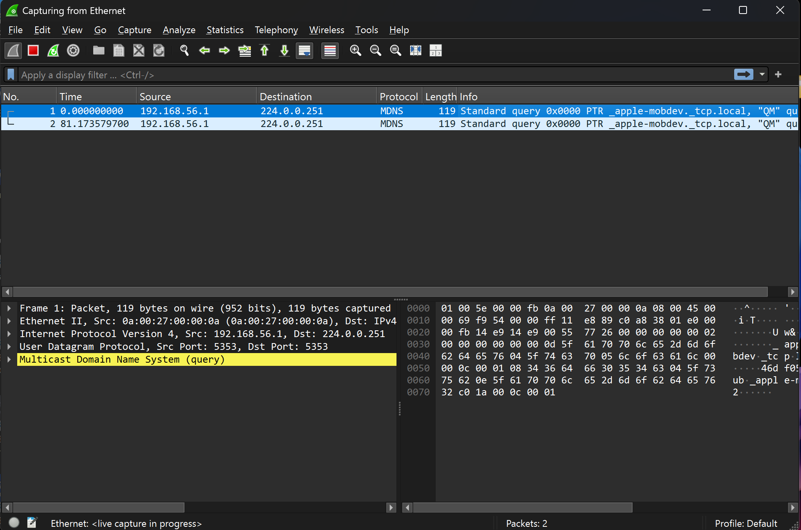

# Работа 3. Первое знакомство с Wireshark

Для проверки захвата открыт сетевой интерфейс и просмотрены полученные кадры. Пример показывает multicast DNS: в списке видны отправитель, адрес группы и протокол, а ниже — разобранные уровни Ethernet, IPv4 и UDP.

Вторая копия того же снимка сохранена отдельно: [открыть файл](assets/screenshots/02-ethernet-capture-copy.png).
