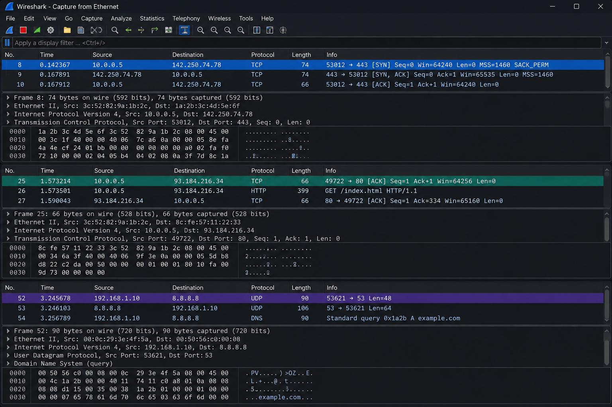

# Работа 13. Пакеты транспортного уровня

Снимок Wireshark объединяет несколько примеров трафика. В верхней части видны три шага открытия TCP-соединения, ниже — HTTP-запрос поверх TCP, а в нижнем блоке — DNS-обмен через UDP.

